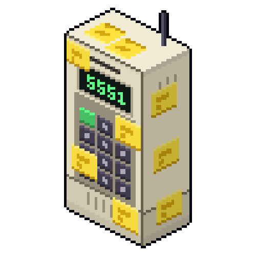
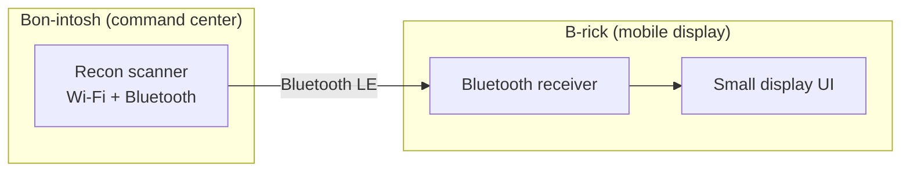

  

<h1 align="center">B-RICK</h1>

  <b>MOBILE RECON DISPLAY</b> 
  <b>BLUETOOTH FIELD COMPANION</b> 
  <b>DISTRIBUTED THREAT ASSESSMENT</b> 
  <b>EMBEDDED SYSTEMS SECURITY LAB</b>

  
  
  

  

<!-- TODO: one good photo of the build. (turnaround like the Bon-intosh) -->

A hand-held, retro-styled companion device built into a DynaTAC-style brick phone shell. **B-rick** is the mobile half of the Bon System. It receives scan data from the **Bon-intosh** command center over Bluetooth and shows it on a small display, so reconnaissance results can travel with me instead of staying on the desk.

Built by Bon Varlet as a hands-on project in embedded systems and security tooling.

> **Status:** Planned. The Bon-intosh is being built first, and B-rick follows. This README describes the design and the open questions. Nothing here is working yet.

**The [B-Together Project](https://github.com/BA-Varlet/BA-Varlet):**
- [Bon-intosh](https://github.com/BA-Varlet/Bon-intosh): the command center (hardware, setup, and base configuration)
- **B-rick** (this repo): the mobile companion
- [Bon software](https://github.com/BA-Varlet/BON-Software): the security tools and scripts that run on both

---

## Why I'm building this

A single deck is a good project, but two devices that talk to each other is a systems problem. B-rick forces me to deal with a second hardware platform, a wireless data link, power and size constraints, and a UI on a very small screen.

## System overview

| Device | Role | Status |
|---|---|---|
| **Bon-intosh** | Command center: runs the scanner and dashboard | Building |
| **B-rick** | Mobile display: receives and shows scan data | Planned |

## Hardware: B-rick

| Part | Notes |
|---|---|
| Board | [TBA] |
| Display | [TBA] |
| Shell | DynaTAC-style brick phone case |
| Bluetooth | [TBH] |
| Power | [TBH] |

## Planned behavior

- Receive scan summaries from Bon-intosh over Bluetooth LE
- Show nearby networks and devices with signal strength
- Flag newly seen devices
- Keep working on battery, away from the deck

## Open design questions

These are the problems I still need to solve, and I'll document the answers here as I go:

- Which board gives the best balance of Bluetooth support, screen support, and battery life inside the shell?
- How should the two devices pair and exchange data, and what message format should the link use?
- How much can a very small display show before it becomes unreadable?
- What's the real battery life, and how do I extend it?

## Roadmap

- [x] Concept and naming
- [ ] Choose board and display
- [ ] Fit the hardware into the shell
- [ ] Boot and display something
- [ ] Bluetooth link to Bon-intosh
- [ ] Show live scan data
- [ ] Write-up of lessons learned

## Build log

| Date | Update |
|---|---|
| [9/20/2026] | Project planned |

<!-- Add one line per milestone, ideally with a photo. Include things that went wrong;-->

## Responsible use

This project is for learning and for testing networks and devices that I own or have explicit permission to assess. Scanning or attacking systems without authorization is illegal and unethical.

## What I'm learning

- [BLE basics, power budgeting, designing for a tiny display]

## License

[MIT]

The shell was bought by a reseller, and I do not hold the rights to the DynaTAC brick phone

